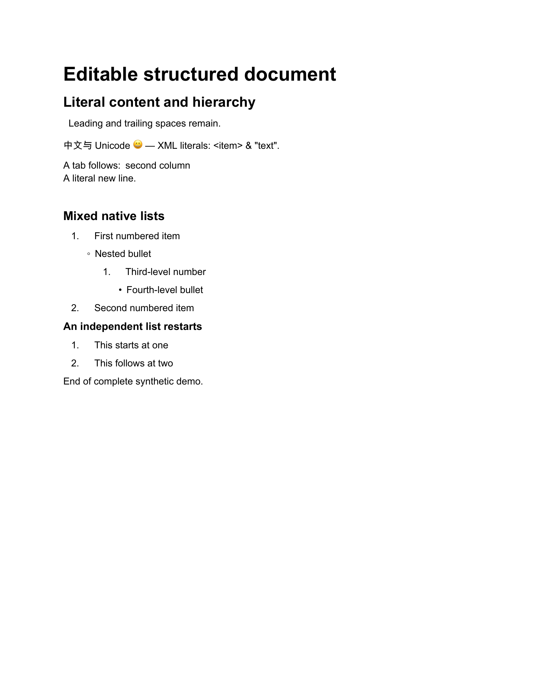

# Structured DOCX

**把结构化内容变成可编辑的 Word，再逐块核对实际生成内容。**

Editable Word generation with complete ordered-content readback for a bounded document model.



## 解决什么问题

报告能下载，只说明产生了一个文件。段落漏失、列表层级改变、顺序颠倒和数字前缀伪装成编号，仍会让交付失真。本工具把生成与实际 OOXML 内容核对分开，提供可检查的结果与明确的未验证项。

适合结构化报告、文本交付和需要复核内容保真的工具开发者。

## 快速开始

需要 Python 及 `python-docx`；依赖安装由使用者选择，仓库不包含第三方包或字体。

```sh
python3 -m pip install -r requirements.txt
python3 -B -m unittest discover -s tests -p 'test_structured_docx.py' -v
```

在仓库根目录运行下面的合成示例。它在内存中生成并核对，不写输入或输出文件：

```sh
python3 -B - <<'PYTHON'
from examples.structured_docx_demo import demo
source, rendered, checked = demo()
assert checked.status == "PASS"
print(checked.status, rendered.docx_size, rendered.docx_sha256)
PYTHON
```

现成制品：[源 JSON](examples/synthetic-source.json) · [可编辑 DOCX](examples/synthetic-editable.docx) · [完整接口与边界](docs/structured_docx.md)。

## 已支持

- 显式标题、1–3 级标题、段落和四层原生混合列表。
- 保留支持范围内的 Unicode、空白、制表和换行。
- 对实际包中完整有序内容、层级和绑定身份进行核对。
- 区分 `PASS`、`FAIL` 与 `NOT_VERIFIED`，保留缺少可信预期身份等限制。

## 使用边界

它不是任意 Word 文件的全功能转换器，不支持本模型之外的表格、图片或 PDF；也不证明上游原文完整、事实正确、分享资格或所有环境的分页一致。核对 PASS 需要可信的预期输出和渲染配置身份，任意文件自行计算一个 SHA 不能代替可信来源。输入内容会保留，工具本身不脱敏。

图中的内容全部为合成示例。代码验证、文档内容核对和视觉检查是不同证据层；测试数量和本轮复现环境见[验证记录](VERIFICATION.md)，不能换算成所有真实文档的准确率。

## 许可状态

仓库暂不附加 MIT 等开源许可证；公开展示与后续开源授权分别处理。
